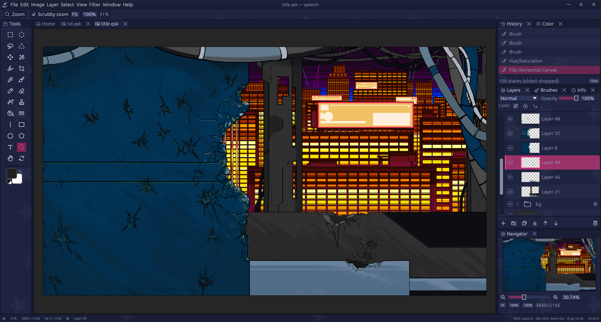

# qsketch

A fast sketching, painting, pixel-art and animation app for the desktop, with
a workflow familiar from Photoshop and Aseprite. Written from scratch in Rust
on `egui` and `wgpu`, so strokes stay responsive on large canvases, with
stylus pressure (Windows Ink, WinTab, Wayland) and a fully remappable
keyboard.



## Features

**Painting**
- Brush engine with separate flow and opacity, pressure curves, thirteen
  presets, and brush tips imported from PNG, GIMP (`.gbr`, `.gih`) and
  Photoshop (`.abr`) files.
- Smudge, Clone Stamp, Liquify, symmetry (mirror or radial) and stroke
  stabilizers. Shift+click draws straight lines.
- Stylus pressure out of the box; tilt and the eraser tip with the optional
  `octotablet` backend.

**Layers and editing**
- 20 blend modes, groups, clipping masks, alpha lock, layer masks, adjustment
  layers, and layer styles (shadow, glow, stroke, color overlay).
- Smart objects that transform without losing quality, editable text layers,
  shape layers, and Trace to Vector with SVG export.
- Selections (rectangle, ellipse, lasso, polygon, magic wand, selection
  brush) with the usual Modify commands, and Free Transform with deform and
  warp.
- 43 filters with live preview, plus an experimental set.
- A linear undo history you can jump around in, rulers and guides, and a
  reference panel.

**Pixel art**
- A document palette with ramps, presets and import from common palette
  files. Lock it for indexed color; Index Colors converts with optional
  dither.
- Pixel-perfect pencil, shading and dither inks, snap to grid, tiled preview,
  RotSprite rotation, non-square pixels.
- Tilemap layers, tileset export, and a Slice tool for 9-slice UI parts.

**Animation**
- Frame animation in an Aseprite-style Timeline: cels, tags, onion skins,
  and import from GIF, APNG, image sequences and sprite sheets.
- Skeletal animation with the Bone tool and Rig panel: bones, two-bone IK,
  weighted meshes, gear drives, skins, a dopesheet and curve graph, and
  crossfades between animations. Bake it to frames, or export a rig for
  games ([`docs/RIG_FORMAT.md`](docs/RIG_FORMAT.md)) with a reference
  JavaScript runtime in [`examples/rig-player`](examples/rig-player).
- Export as GIF, APNG, PNG sequence, sprite sheet with JSON, or MP4 / WebM
  through ffmpeg. Timelapse recording of a document as you paint.

**Files**
- `.qsk`, the native format: a plain ZIP of PNGs plus a JSON manifest
  ([`docs/FILE_FORMAT.md`](docs/FILE_FORMAT.md)).
- Opens and saves Photoshop `.psd` and Aseprite `.ase` / `.aseprite`; opens
  PaintTool SAI 2 `.sai2`.
- Saves PNG, JPEG, WebP, BMP, TGA and TIFF, and says what each format drops
  before it writes.
- Autosave with crash recovery, and previous versions of saved files.

**Interface**
- Dockable panels with SAI 2, Photoshop and Aseprite-style layouts, four
  themes plus a custom palette, and two documents side by side.
- Every command can be rebound
  ([`docs/SHORTCUTS.md`](docs/SHORTCUTS.md) lists the defaults).
- Draw together over [Leyline](https://github.com/mayathegreat/leyline)
  ([`docs/SHARING.md`](docs/SHARING.md)).

## Install

Download from the
[Releases](https://github.com/Cabbit-Labs/qsketch/releases) page.

**Windows:** run `qsketch-<version>-setup.exe`, or unzip
`qsketch-<version>-windows-portable.zip` anywhere. The installer adds the
`.qsk` file association and Explorer thumbnails; portable users can turn the
thumbnails on under Preferences ▸ General ▸ Explorer.

**Linux:**

```sh
tar xzf qsketch-*-linux-x86_64.tar.gz
cd qsketch-*-linux-x86_64
./install.sh          # installs into ~/.local, or a prefix you pass
```

This also registers the `.qsk` file type and a thumbnailer for file managers.

**Updates:** qsketch can update itself from a signed manifest. Enter the
manifest URL your distributor gives you under Preferences ▸ General ▸
Updates; without one, get new versions from the Releases page. Maintainers:
see [`docs/RELEASING.md`](docs/RELEASING.md).

## Build from source

```sh
git clone https://github.com/Cabbit-Labs/qsketch.git
cd qsketch
cargo run --release -p qsketch
```

On Debian or Ubuntu, install the build dependencies first:

```sh
sudo apt-get install libgtk-3-dev libxkbcommon-dev libwayland-dev libx11-dev pkg-config
```

On Windows, build with the MSVC toolchain. `scripts/build-windows.sh`
cross-compiles from Linux and packages the installer and portable ZIP (it
needs mingw-w64 and `makensis`).

## Getting started

qsketch opens on a Home tab: create a document or open a file. Tools are on
the left; Color, Layers, History and the other panels are on the right. Drag
any panel's tab to float or re-dock it, and use Window ▸ Workspace to switch
layouts or reset them.

If pen pressure isn't registering, check Edit ▸ Preferences ▸ Tablet & Pen.

## Settings

Preferences, brush presets, swatches, shortcuts and the panel layout are kept
in one TOML file:

| Platform | Path |
| --- | --- |
| Windows | `%APPDATA%\cabbit-labs\qSketch\config\settings.toml` |
| Linux | `~/.config/qsketch/settings.toml` |
| macOS | `~/Library/Application Support/dev.cabbit-labs.qSketch/settings.toml` |

macOS is not packaged for release yet.

## Documentation

- [`docs/SHORTCUTS.md`](docs/SHORTCUTS.md): every action and its default key.
- [`docs/FILE_FORMAT.md`](docs/FILE_FORMAT.md): the `.qsk` container.
- [`docs/RIG_FORMAT.md`](docs/RIG_FORMAT.md): the rig export for games.
- [`docs/SHARING.md`](docs/SHARING.md): drawing together over Leyline.
- [`docs/ARCHITECTURE.md`](docs/ARCHITECTURE.md): how the crates, raster
  engine and renderer fit together.
- [`docs/ROADMAP.md`](docs/ROADMAP.md): what has shipped and what hasn't.
- [`docs/RELEASING.md`](docs/RELEASING.md): cutting a signed release.
- [`CONTRIBUTING.md`](CONTRIBUTING.md): dev setup and how to add tools,
  actions and panels.
- [`CHANGELOG.md`](CHANGELOG.md): what changed in each release.

## License

Dual-licensed under either the [MIT License](LICENSE-MIT) or the
[Apache License, Version 2.0](LICENSE-APACHE), at your option.

## Credits

- [`egui`](https://github.com/emilk/egui) and `eframe`: the UI framework.
- [`wgpu`](https://github.com/gfx-rs/wgpu): the GPU renderer.
- [`egui_dock`](https://crates.io/crates/egui_dock): the dockable workspace.
- [Phosphor Icons](https://phosphoricons.com/) (MIT): the icons.
- [visioncortex](https://github.com/visioncortex/visioncortex) and
  [VTracer](https://github.com/visioncortex/vtracer): image tracing;
  [tiny-skia](https://github.com/linebender/tiny-skia): drawing the traced
  shapes.
- [libsai](https://github.com/Wunkolo/libsai) and the
  [Photopea SAI2 specification](https://github.com/photopea/SAI2-specification):
  the basis of the `.sai2` reader.
- [`octotablet`](https://crates.io/crates/octotablet): the optional tablet
  backend.

See [THIRD_PARTY_NOTICES.md](THIRD_PARTY_NOTICES.md) for license details.
